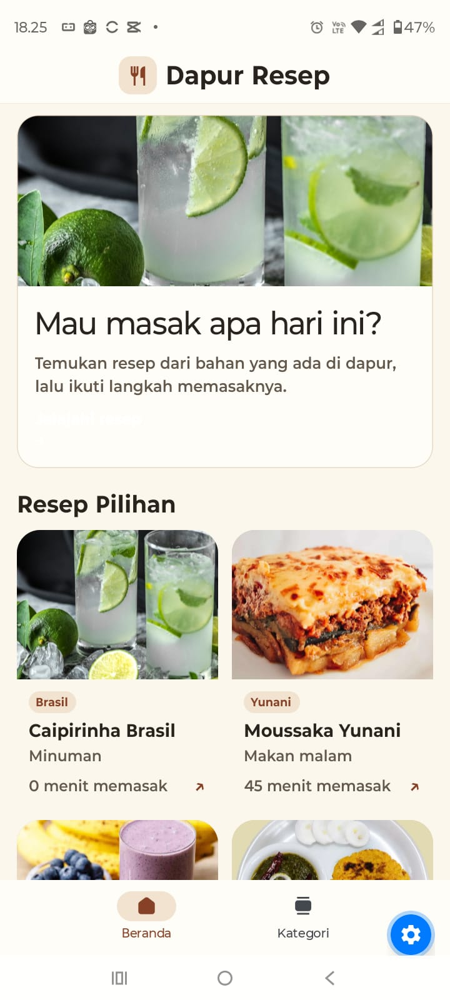
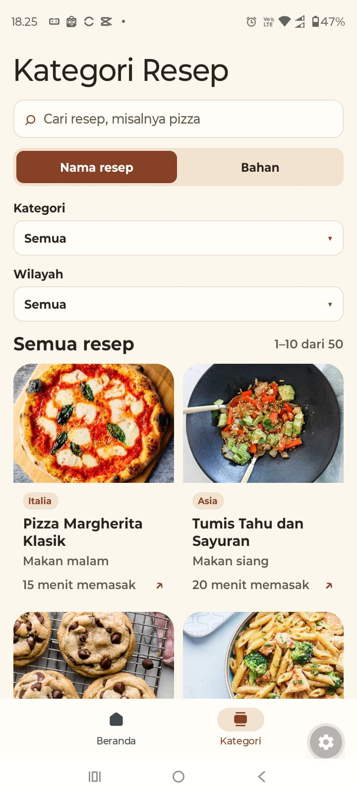
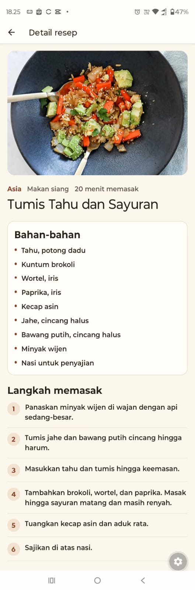

# Dapur Resep

Dapur Resep adalah aplikasi [React Native](https://reactnative.dev/) berbasis **JavaScript** untuk UTS Pemrograman Mobile Lanjut. Proyek ini menggunakan template [Expo SDK 58](https://docs.expo.dev/versions/v58.0.0/), [Expo Router](https://docs.expo.dev/router/introduction/), dan [TanStack Query](https://tanstack.com/query). Data resep diambil dari [DummyJSON Recipes API](https://dummyjson.com/docs/recipes) tanpa API key.

## Fitur Aplikasi

- **Beranda** menampilkan pengantar aplikasi dan empat resep pilihan acak setiap kali tab dibuka. Judul Dapur Resep tetap terlihat saat halaman digulir.
- **Kategori** menampilkan foto, nama, kategori, asal masakan, dan durasi memasak jika tersedia. Hasil ditampilkan hingga 10 resep per halaman.
- **Pencarian dan filter** mendukung nama resep, bahan makanan, serta dropdown kategori dan negara atau wilayah. Kata kunci Indonesia maupun Inggris dapat digunakan.
- **Detail resep** memuat foto, daftar bahan, dan langkah memasak berdasarkan ID resep. Nama khas seperti *Aloo Keema* dan *Margherita* dipertahankan dalam pelokalan bahasa Indonesia.

## Struktur Folder dan Arsitektur

Proyek memisahkan rute dan tampilan, akses data, pelokalan, serta fungsi pendukung. Expo Router membaca struktur dalam `src/app/` untuk menentukan rute dan tata letak navigasi.

```text
dapur-resep/
├── app.json                         # Konfigurasi Expo
├── package.json                     # Dependensi dan perintah npm
├── jsconfig.json                    # Alias impor @/
├── assets/                          # Ikon aplikasi dan navigasi
└── src/
    ├── app/
    │   ├── _layout.js               # QueryClientProvider, tema, dan Stack
    │   ├── (tabs)/
    │   │   ├── _layout.js           # Tata letak tab bawah
    │   │   ├── index.js             # Beranda dan resep pilihan
    │   │   └── kategori.js          # Katalog, pencarian, filter, dan paginasi
    │   └── resep/
    │       └── [id].js              # Detail resep berdasarkan ID
    ├── api/
    │   └── recipes.js               # Permintaan REST API dan opsi query
    ├── components/
    │   ├── app-tabs.js              # Navigasi bawah Android dan iOS
    │   ├── app-tabs.web.js          # Navigasi bawah web
    │   ├── recipe-card.js           # Kartu di Beranda dan Kategori
    │   ├── recipe-filter-row.js     # Dropdown kategori dan negara
    │   ├── recipe-pagination.js     # Kontrol halaman daftar resep
    │   └── recipe-status.js         # Tampilan pemuatan, galat, dan hasil kosong
    ├── constants/
    │   └── theme.js                  # Warna, tipografi, dan ukuran
    ├── hooks/                       # Hook tema terang dan gelap
    ├── localization/
    │   ├── recipes.js               # Logika pelokalan dan pencocokan teks
    │   └── recipes-id.json          # Kamus nama, bahan, dan langkah memasak
    └── utils/
        ├── random-recipes.js        # Pemilihan resep acak
        └── recipe-pagination.js     # Pembagian hasil menjadi 10 resep per halaman
```

Alur pengambilan data adalah **halaman → `useQuery` → opsi query di `src/api/recipes.js` → `fetch` → DummyJSON**. Lapisan API memeriksa status HTTP dan membaca respons JSON. Data hasil query kemudian dipakai untuk membangun katalog, mencocokkan pencarian, dan menampilkan konten dalam bahasa Indonesia. Pelokalan menampilkan teks sumber ketika padanannya belum tersedia.

## State Management dan REST API

`src/app/_layout.js` menyediakan satu `QueryClient` melalui `QueryClientProvider`. Beranda, Kategori, dan Detail memakai `useQuery` untuk mengakses *server state*.

| Data | Query key | Endpoint |
| --- | --- | --- |
| Katalog lengkap | `['recipes', 'list', '']` | `GET /recipes?limit=0` |
| Pencarian nama | `['recipes', 'list', keyword]` | `GET /recipes/search?q=<kata-kunci>&limit=0` |
| Detail resep | `['recipes', 'detail', id]` | `GET /recipes/{id}` |

- Data dianggap fresh selama **5 menit** melalui `staleTime`. Query yang tidak digunakan dapat tetap tersimpan di memori selama **15 menit** melalui `gcTime`.
- Query gagal dicoba ulang **satu kali** secara otomatis. Tampilan menyediakan indikator pemuatan dan tombol **Coba lagi**. Daftar Kategori juga mendukung tarik untuk memuat ulang pada perangkat seluler.
- Pencarian nama menunggu **350 ms** setelah pengguna berhenti mengetik. Hasil API digabungkan berdasarkan ID dengan resep dari katalog yang cocok dengan nama asli atau nama Indonesianya.
- Pencarian bahan memfilter `ingredients` pada katalog di aplikasi, dengan mencocokkan istilah asli dan terjemahan. Dropdown kategori dan negara atau wilayah juga memfilter hasil secara lokal.
- Teks pencarian, mode nama atau bahan, pilihan dropdown, dan halaman aktif disimpan melalui `useState`. Paginasi diterapkan setelah pencarian dan filter, sehingga setiap halaman memuat hingga 10 hasil yang sesuai.

## Tangkapan Layar Aplikasi

| Tampilan | Nama file  | Bagian yang ditampilkan |
| --- | --- | --- |
| Home | `screenshot/home.jpeg` | Judul, resep pilihan, dan bilah tab bawah. |
| Kategori | `screenshot/kategori.jpeg` | Pencarian, dropdown filter, dan kartu resep dengan label asal. |
| Detail | `screenshot/detail-resep.jpeg` | Foto hidangan, bahan, dan langkah memasak. |

| Home | Kategori | Detail |
| --- | --- | --- |
|  |  |  |

## Menjalankan Aplikasi

### 1. Instal dependensi dan jalankan Metro

Gunakan **Node.js 24.3 atau lebih baru dalam seri 24** dan npm. Buka terminal di folder proyek `dapur-resep`, lalu jalankan:

```sh
npm install
npm start
```

Sambungan internet diperlukan untuk mengambil data dan gambar resep.

### 2. Buka aplikasi

| Platform | Cara menjalankan |
| --- | --- |
| Ponsel Android atau iOS | Pindai kode QR dari terminal menggunakan Expo Go yang kompatibel dengan SDK 58. |
| Emulator Android | Jalankan emulator, lalu tekan `a` di terminal Expo atau jalankan `npm run android`. |
| Simulator iOS di macOS | Siapkan simulator Xcode, lalu tekan `i` di terminal Expo atau jalankan `npm run ios`. |
| Browser | Tekan `w` di terminal Expo atau jalankan `npm run web`. |

### 3. Edit kode

Edit `src/app/(tabs)/index.js` untuk Beranda, `src/app/(tabs)/kategori.js` untuk katalog, atau `src/app/resep/[id].js` untuk detail. Perubahan biasanya terlihat segera melalui Fast Refresh. Tekan `r` di terminal Expo jika perlu memuat ulang.

Untuk memeriksa kode, jalankan `npm run lint`.

## Uji Cepat

1. Buka **Beranda**, lalu pilih **Jelajahi resep**. Buka salah satu kartu untuk memeriksa detailnya.
2. Di **Kategori**, pilih **Italia** di dropdown negara atau wilayah dan ketik `pizza` dalam mode **Nama resep**.
3. Kembalikan filter negara ke **Semua**, pilih mode **Bahan**, lalu bandingkan hasil `bawang putih` dan `garlic`.
4. Hapus pencarian dan pilih **Berikutnya** setelah kartu ke-10. Ubah filter dan pastikan halaman kembali ke awal.
5. Jika permintaan gagal, pulihkan koneksi lalu pilih **Coba lagi**.

## Pemecahan Masalah

| Kendala | Tindakan |
| --- | --- |
| Expo Go menampilkan versi SDK yang tidak kompatibel | Gunakan Expo Go yang mendukung SDK 58 atau jalankan versi web dengan `npm run web`. |
| Ponsel tidak tersambung ke Metro | Pastikan ponsel dan komputer berada di jaringan yang sama. |
| Tampilan lama masih muncul setelah perubahan | Jalankan `npx expo start --clear` untuk membersihkan cache Metro. |
| Data resep atau foto tidak tampil | Periksa koneksi ke DummyJSON, lalu tekan **Coba lagi** jika tombol tersedia. |

## Referensi

- [Expo SDK 58](https://docs.expo.dev/versions/v58.0.0/)
- [Panduan menjalankan proyek Expo](https://docs.expo.dev/get-started/start-developing/)
- [Expo Router](https://docs.expo.dev/router/introduction/)
- [TanStack Query](https://tanstack.com/query)
- [DummyJSON Recipes API](https://dummyjson.com/docs/recipes)
